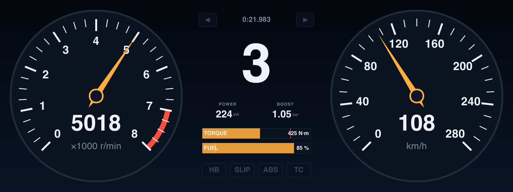
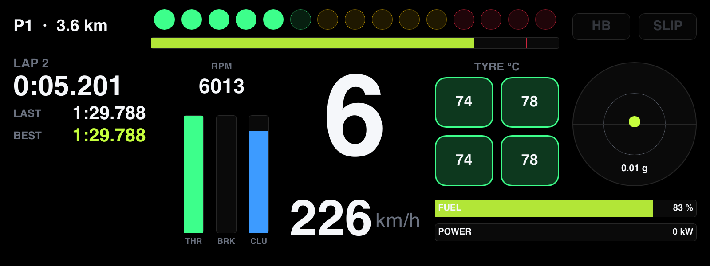
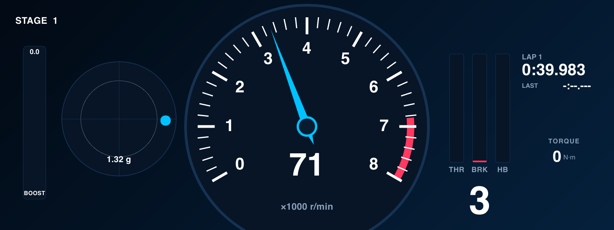
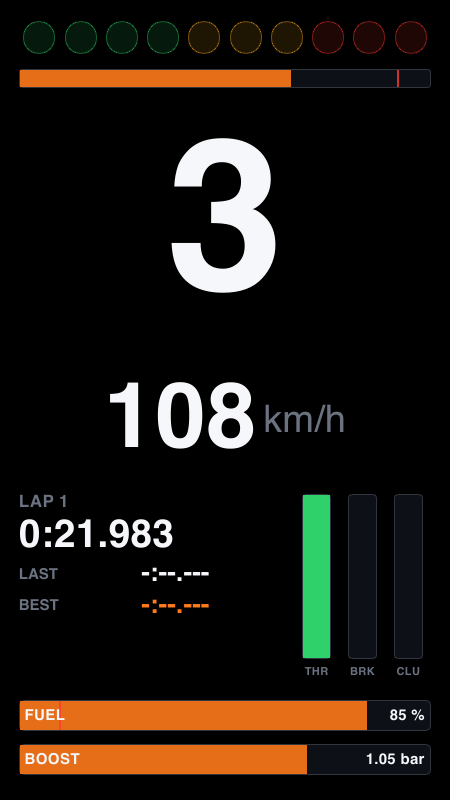
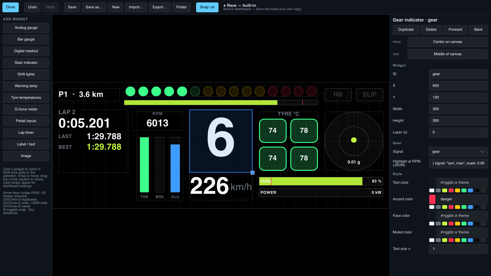

# DashCluster

[](https://github.com/Alexxfromgit/DashCluster/actions/workflows/ci.yml)
[](https://github.com/Alexxfromgit/DashCluster/releases/latest)
[](LICENSE)
[](https://slint.dev)

A customizable digital instrument cluster for racing games. Drive in **Forza Horizon 5** and see
your speed, revs, gear, shift lights, tyres and lap times on a second screen, on your phone, and on
other computers on your network, all at once. Design your own dashboards in the built-in editor.



Written in Rust with [Slint](https://slint.dev). The same dashboards render natively on Windows,
macOS and Linux and, compiled to WebAssembly, in any phone or tablet browser.

## What is in it

| Area | Details |
|---|---|
| Games | Forza Horizon 4/5, Forza Motorsport (2023) and Forza Motorsport 7 via *Data Out* (UDP). Built so other sims and real cars (OBD-II) can be added as sources |
| Dashboards | 12 widgets: analog and bar gauges, digital readouts, gear, shift lights, warning lamps, tyre temperatures, g-meter, pedal inputs, lap timer, text with live values, images. Four original sample designs |
| Editor | Visual editor (move, resize, snap, align, undo/redo, property inspector) or plain JSON5 files that reload when saved; `.cluster` packages to share dashboards with their images |
| Screens | Desktop window (fullscreen, always on top), phone/tablet browser via QR code (no app to install), other computers mirror the first one automatically |
| Units | Metric or imperial per quantity (speed, temperature, pressure, power, torque), also on phones; gauge scales re-round themselves |
| Tools | Demo car, session recording and replay (`.ctlog`), a fake Forza sender for testing without the game, headless PNG rendering |

| Race | Rally | Phone | Editor |
|---|---|---|---|
|  |  |  |  |

## Download

Get the latest version from [Releases](https://github.com/Alexxfromgit/DashCluster/releases/latest):

| Platform | File |
|---|---|
| Windows 10/11 (x64) | `DashCluster-<version>-windows.zip` → unzip, run `DashCluster.exe` |
| macOS 11+ (Apple silicon) | `DashCluster-<version>-macos.dmg` |
| Linux (x64, glibc 2.35+: Ubuntu 22.04, Debian 12 or newer) | `DashCluster-<version>-linux-x64.tar.gz` |

`SHA256SUMS.txt` on each release lists the checksums, and every file's build provenance can be
checked with `gh attestation verify <file> -R Alexxfromgit/DashCluster`. The builds are not
code-signed yet: Windows SmartScreen asks you to confirm ("More info" → "Run anyway"), and macOS
needs right-click → Open the first time.

## Connect Forza Horizon 5

The first launch shows these steps with your computer's address filled in (**H** shows them again).

1. **In the game:** Settings → HUD and Gameplay → **Data Out: On**.
2. **Data Out IP Address:** the computer running DashCluster. **Port:** `5300`.
3. **Game and DashCluster on the same Windows PC** (Microsoft Store / Xbox app version of FH5):
   Windows blocks apps from sending to their own PC. Allow it once in an administrator PowerShell,
   then use `127.0.0.1` as the address:
   ```powershell
   Get-AppxPackage *Forza* | % { CheckNetIsolation LoopbackExempt -a -n="$($_.PackageFamilyName)" }
   ```
   Not needed when DashCluster runs on another computer (e.g. a laptop next to your PC or console).
4. Allow DashCluster on **private networks** when Windows Firewall or macOS asks.
5. **Phone:** press **Q** and scan the QR code (same Wi-Fi). Tap the left/right edge to change
   dashboards, the middle for fullscreen. On iPhone, Share → *Add to Home Screen* gives a
   full-screen app. Phones only let secure (HTTPS) pages keep the screen awake, so turn off
   auto-lock while you drive (iPhone: Display & Brightness → Auto-Lock; Android: Display →
   Screen timeout). Image widgets and background images show on the computer only, not yet on
   phones.
6. **Another computer:** run DashCluster there and choose Settings (**P**) → Source →
   *Another DashCluster*; it finds the first one by itself.

Forza does not send coolant/oil temperature, ABS/TC or indicator data, so widgets bound to those
stay dimmed with Forza. The sample dashboards use what Forza provides.

## Keys

| Key | |
|---|---|
| ← → | Previous / next dashboard |
| E | Edit the current dashboard |
| P · H · Q | Settings · setup guide · phone QR code |
| D | Switch to the demo car and back |
| U · F · S | Metric/imperial · fullscreen · status bar |

In the editor: click / Shift-click to select, drag to move, drag the corner square to resize,
arrow keys to nudge (Shift: 10), Delete, Ctrl/⌘+D duplicate, Ctrl/⌘+Z undo (+Shift redo),
Ctrl/⌘+S save, G snap, Esc deselect.

## Your dashboards

Saved in `%APPDATA%\DashCluster\dashboards` (Windows), `~/Library/Application Support/DashCluster/dashboards`
(macOS) or `~/.local/share/DashCluster/dashboards` (Linux), next to `settings.json`. Edit them in
the app (**E**) or in any text editor; the app reloads a dashboard when its file is saved. The format
is documented in [docs/dashboard-format.md](docs/dashboard-format.md).

## Build and run

You need [Rust](https://rustup.rs) 1.92 or newer (stable). Everything else is fetched by Cargo.

- **Windows:** install Rust with `rustup-init.exe`; when it asks, let it install the Visual Studio
  C++ Build Tools (the "Desktop development with C++" workload).
- **macOS:** `xcode-select --install`, then rustup.
- **Linux:** `sudo apt-get install -y pkg-config libfontconfig1-dev libxkbcommon-dev` (or your
  distribution's equivalents), then rustup.

```bash
git clone https://github.com/Alexxfromgit/DashCluster.git
cd DashCluster
cargo run --release -p cluster-desktop                    # listens for Forza on UDP 5300
cargo run --release -p cluster-desktop -- --source demo   # or drive the demo car
```

The phone display is a separate WebAssembly build that the desktop app embeds when it is compiled.
Build it once before the desktop app (it installs the `wasm32` target and the matching
`wasm-bindgen` CLI on first use); without it, phones see a short "not built" page:

```bash
./scripts/build-web.sh            # Windows: .\scripts\build-web.ps1
cargo run --release -p cluster-desktop
```

More: [CONTRIBUTING.md](CONTRIBUTING.md) (tests, tools, packaging, releases),
[docs/architecture.md](docs/architecture.md) (how it fits together),
[docs/testing-with-forza.md](docs/testing-with-forza.md) (a checklist for trying every workflow
with the real game).

## License

[MIT](LICENSE). DashCluster uses [Slint](https://slint.dev) under the Slint Royalty-free License
and other open-source libraries; see [THIRD-PARTY-NOTICES.md](THIRD-PARTY-NOTICES.md). Every
download includes the full license texts (`THIRD-PARTY-LICENSES.txt`). The dashboard
designs are original. Forza, Forza Horizon and Forza Motorsport are trademarks of Microsoft; this
project is not affiliated with or endorsed by Microsoft or Playground Games.
